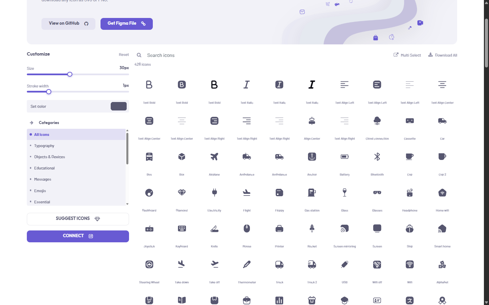
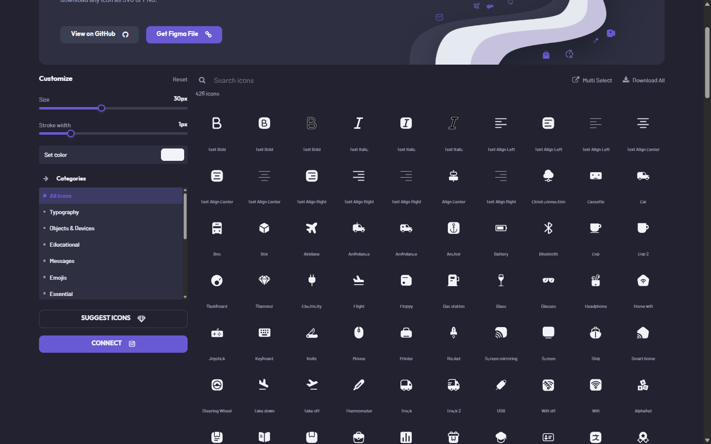

# 🎨 IconPaq

**IconPaq** – A free, fully responsive icon library built with **HTML, CSS and Vanilla JavaScript**.
426 hand crafted outline icons across 14 categories, with live size, stroke and color controls, style variants for every icon and one click export to **SVG or PNG** — all without a single build step.

> ⚡ **Portfolio-Level Project** – Showcasing Senior Front-End expertise in **icon system design, live SVG manipulation, themeable design tokens and zero-dependency front-end work**.

[](https://github.com/condev-dev/iconpaq)
[](https://github.com/condev-dev/iconpaq)
[](https://github.com/condev-dev/iconpaq)
[](https://github.com/condev-dev/iconpaq)
[](https://github.com/condev-dev/iconpaq)
[](https://github.com/condev-dev/iconpaq)
[](https://github.com/condev-dev/iconpaq)
[](LICENSE)

---

## 🛠 Tech Stack

[](https://developer.mozilla.org/docs/Web/HTML)
[](https://developer.mozilla.org/docs/Web/CSS)
[](https://sass-lang.com/)
[](https://developer.mozilla.org/docs/Web/JavaScript)
[](https://developer.mozilla.org/docs/Web/SVG)

Every runtime library — Bootstrap, jQuery, Font Awesome and html2canvas — is **vendored inside the repository**, so the page makes zero third party requests and works completely offline.

---

## ✨ Key Features

- 🧭 **Icon Library** – 426 outline icons grouped in 14 categories, laid out eight per row on desktop
- 🔍 **Instant Search** – Typing filters the grid as you go and the result counter follows along
- 🗂 **Category Filter** – One click narrows the library to a single category and **All Icons** brings it back
- 🎛 **Live Customize Panel** – Size, stroke width and color sliders that repaint the whole grid in real time
- 🎨 **Smart Recolor** – The palette rewrites every icon path, while genuinely multi color icons keep their own palette
- 🧲 **Style Variants** – Each icon ships several drawing styles, switchable from the strip inside the dialog
- 💾 **Export SVG & PNG** – Download the open icon as clean SVG or as a 4× PNG with a transparent background
- 📦 **Multi Select Mode** – Tick as many icons as you like and export the whole selection in one go
- 📋 **Copy Ready Code** – The dialog exposes the icon name, the full SVG markup and the inner component markup
- 🌗 **Light & Dark Theme** – Follows the system preference on the first visit and remembers your choice afterwards
- 📱 **Fully Responsive** – Three icons per row on phones, the dialog stacks into a single column and scrolls safely
- ⚡ **No Build Step** – Plain HTML, CSS and JavaScript, with self hosted Barlow and Outfit webfonts

---

## 📸 Visual Preview

<div align="center">

### 🧭 Icon Library

*A searchable grid of 426 icons with the category filter and the live customize panel on the left.*



---

### 🌙 Dark Theme

*The same library in dark mode, driven by CSS custom properties and remembered between visits.*



</div>

---

## 🗂 Pages

| Page | What it does |
| --- | --- |
| `index.html` | The icon library itself: search, category filter, customize panel and the icon detail dialog |
| `suggestUs.html` | Request form for icons that are missing from the set |

---

## 🧩 Project Structure

| Path | Description |
| --- | --- |
| `Assets/css/base.css` | Design tokens, header, footer, buttons, form controls and shared components |
| `Assets/css/index.css` | Icon grid, customize panel, toolbar, multi select pill and the detail dialog |
| `Assets/css/suggest.css` | Request page layout, purple info card and form styling |
| `Assets/css/theme-dark.css` | Dark theme tokens and the few dark only overrides |
| `Assets/sass` | The Sass sources the four stylesheets are compiled from |
| `Assets/js/Custom.js` | Theming, filtering, dialog, clipboard, multi select and the export pipeline |
| `Assets/fonts` | Self hosted Barlow and Outfit webfonts |
| `Assets/img` | Logo, favicon, hero and form artwork, plus the readme screenshots |
| `Assets/vendor` | Self hosted Bootstrap, jQuery, Font Awesome and html2canvas |

---

## ⚙️ How It Works

1. Search by name or pick a category from the sidebar
2. Click any icon to open its detail dialog
3. Flip through the available style variants underneath the preview
4. Set the color, or adjust size and stroke width from the left panel
5. Copy the SVG markup, or download the icon as SVG / PNG
6. Turn on **Multi Select** to collect several icons and export them in one batch

---

## 🚀 Setup

```bash
git clone https://github.com/condev-dev/iconpaq.git
cd iconpaq
open index.html
```

No install, no build, no dependencies. Just open it in a browser.

### Rebuilding the stylesheets

`Assets/css` is generated from `Assets/sass`. After changing anything under `sass/`:

```bash
npx sass --no-source-map --style=expanded Assets/sass/base.scss Assets/css/base.css
npx sass --no-source-map --style=expanded Assets/sass/index.scss Assets/css/index.css
npx sass --no-source-map --style=expanded Assets/sass/suggest.scss Assets/css/suggest.css
npx sass --no-source-map --style=expanded Assets/sass/theme-dark.scss Assets/css/theme-dark.css
```

---

## 📄 License

[MIT](LICENSE)

**© ConDev** – free to use in personal and commercial projects.

---

### 🔗 Links

- 🧑‍💻 GitHub – **[github.com/condev-dev](https://github.com/condev-dev)**
- 📄 Resume & Portfolio – **[cv.condev.ir](https://cv.condev.ir)**
- 📸 Instagram – **[@con.dev](https://www.instagram.com/con.dev)**
